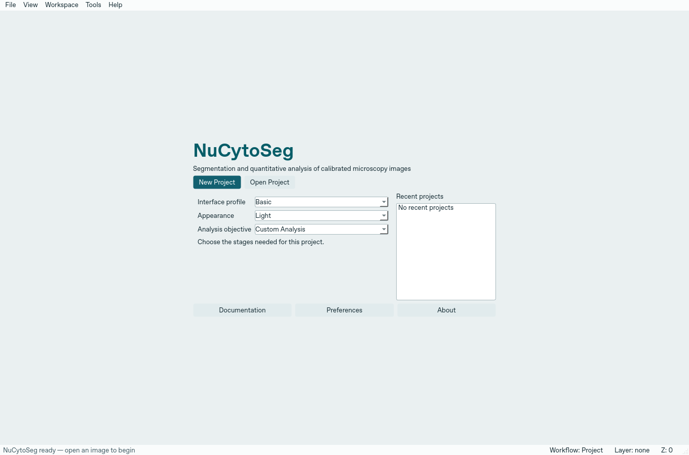
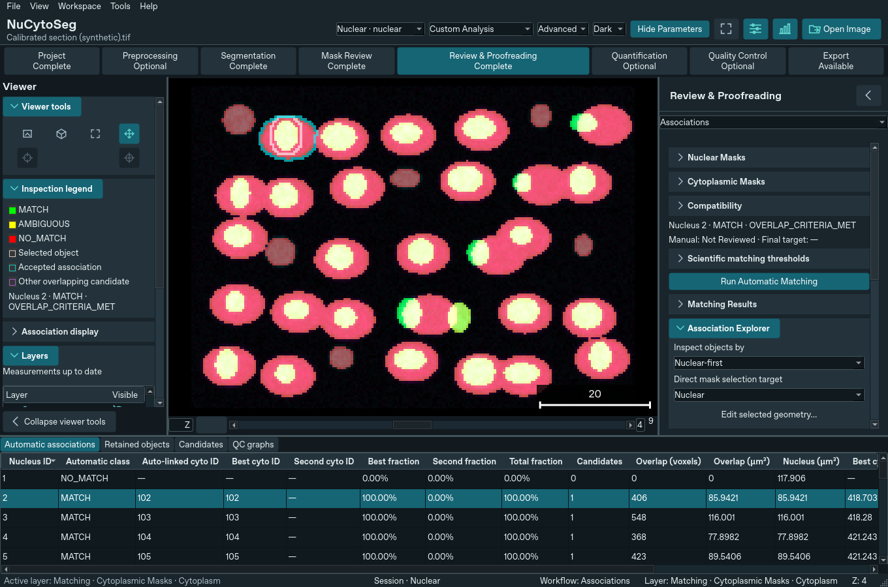
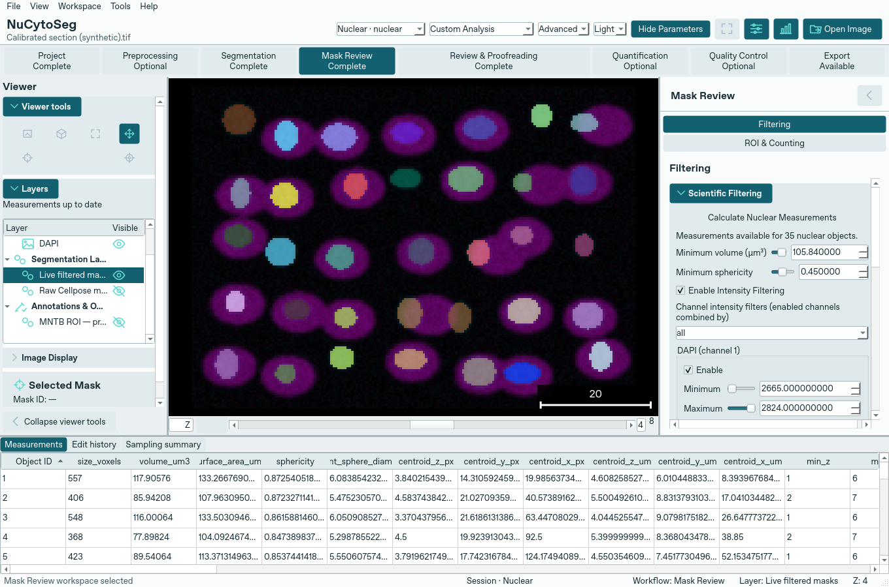

# NuCytoSeg Phase 3A

## Entry regression gate

The development branch resolved to `0a5aa3d595fb573f9950bebcf6e80541c847676c` before implementation. The remote main reference was `2fed532706aa56122fe7091586722d643fc189b7`. The Phase 2 completion handoff records coverage of 450 collected tests and 13 scientific subtests at entry. It records one intermittent preprocessing worker timeout.

The local comparison uses Python 3.12.14, PyQt6 6.11.0 (Qt 6.11.2), qtpy 2.4.3, napari 0.10.0 and pytest 9.2.0 with Xorg, xcb and Mesa software OpenGL. The broad invocation is `python -m pytest -q --ignore=tests/test_live_plots.py --deselect=tests/test_workflow.py::test_launcher_preview_worker_does_not_run_cellpose`. Those five cases run in separate processes, following the Phase 2 handoff. The suite includes scientific unit tests, Qt tests using a QWidget canvas stand-in and explicit embedded QtViewer/VisPy tests.

## Desktop technology decision

| Option | Decision |
| --- | --- |
| Native Qt widgets and scoped Qt Style Sheets | Keep the Qt event loop, accessibility names, focus order, keyboard shortcuts and OS font selection. Use device-independent dimensions and native vector painting for scaling. Palette roles cover controls, tables, popups and disabled text. |
| PyQt6 and qtpy | Keep the existing binding, abstraction and distribution terms. PyQt6 is GPL or commercially licensed. Packaging on macOS and Windows still requires the matching Qt platform and OpenGL plugins. |
| Embedded napari 0.10 | Keep the existing ViewerModel, QtViewer and scientific layer owners. Application appearance belongs to window chrome. Classification colors, calibrated coordinates and label rendering belong to the scientific controllers. Napari uses BSD-3-Clause. |
| QtAwesome | Existing QIconEngine artwork covers the required actions. The MIT-licensed wrapper bundles separately licensed icon fonts. Adding them would require font deployment, license distribution and glyph mapping. |
| superqt | Existing transitive dependency of napari (BSD-3-Clause). Native controls already cover the interaction requirements. No new direct dependency. |
| Native docks or third-party docking | Nested QSplitters support the approved fixed layout and the existing QSettings snapshots. Free docking would add drop targets and another persistence format. External docking libraries would also add bindings, licensing review and platform packaging work. |

Checkpoint readers, scientific defaults, geometry transaction owners and export algorithms remain the Phase 2 implementations.

### Observed entry results

The broad run passed 445 tests and 13 subtests. The isolated launcher worker passed. Three live-plot cases passed on the first invocation. The project Z-profile test saw two of three planes at its fixed 600 ms sample, then passed in a fresh process. All 450 distinct cases passed across the runs. The actual embedded canvas also returned a 760 × 756 screenshot at a 1364 × 900 window size. Baseline native checkpoints and the six files from the exact-ID export fixture were retained for cross-revision comparison.

## 3.0 · Design system

The desktop window applies named semantic colors, native point-sized typography, section headers, control states and keyboard focus through `design_system.py`. The appearance preference lives in QSettings. Switching applies a palette and stylesheet in place. The design-system gate covers both themes, unchanged rendered pixels, camera and parameters, desktop controls at both supported sizes and the Phase 2D.8 classification cases.

## 3.1 · Scientific workspace

`desktop_window.py` owns a horizontal panel splitter inside a vertical results splitter. `workflow_navigation.py` mounts the stage bar above them and the selected subpages in the parameter panel. The active session selector calls the existing guarded session-switch handler. `workflow_progress.py` reads the active session's validity flags and the selected pair's current result. Visiting a page cannot complete a scientific stage.

`results_workspace.py` hosts the original sorted association tables, candidate views and their selection models. Measurements use a read-only Qt adapter over the published DataFrame and its object index. Sampling reads the quantification controller's formatted values, history uses the geometry history model and logs share the controller's text documents. QC reparents the same plot widget when detached. Panel collapse hides the live widgets. QSettings snapshots add optional results visibility, height and tab fields, with defaults for Phase 2 layouts. Native scientific checkpoints require no layout migration.

The approved placement changes required updating desktop layout assertions for the horizontal bar, sidebar ownership, QC docking and visible candidates tab. Scientific assertions for classification, calibrated highlights, camera, sorting and transaction history remain in the regression gate.

The 3.0 gate passed 45 tests. At 3.1, 83 of 84 passed in the workspace/matching/checkpoint group on the first run. The remaining case attempted to scroll the now-hidden Candidates tab. Opening that tab before scrolling restored its intended contract, and all five matching navigation cases passed together. The three result-workspace tests plus import and segmentation workers passed together (24 tests). The protected brush canvas and toolbar cases passed together (2 tests). The appearance/canvas comparison also passed under QT_SCALE_FACTOR=1.5.

## 3.2 · Review & Proofreading

One stage selects Associations, Geometry Editing or Manual Association Review. The two projections of Association Explorer share the pair-owned result, display-only minimum intersection fraction, renderer, explicit picking target and wide results area. The cytoplasmic projection filters accepted counts. The nuclear projection filters candidate multiplicity, class, accepted count and manual status. The optional display threshold uses each intersection divided by the complete nuclear voxel count. The matching controller still receives only its three scientific thresholds. All sparse intersections remain available to scientific export and guided correction.

Matching navigation retains display filters with each ordered pair's inspection location. Direct picking can reveal an object excluded by a row filter. Changing filters clears an unavailable prior selection. Automatic class/reason and the manual/final outcome use separate readouts. Role-aware handoffs reuse the existing guided watershed, merge and ordinary geometry transactions, including their validation, protected brushes, saved Undo and read-only references. The transaction lock covers stage and session controls while the layer tree remains usable.

The focused runs exposed an outdated shutdown signal connection, placement-dependent transaction lock, an assertion tied to the previous accepted-count checkbox and a combined label that obscured the previously separate automatic readout. These were corrected before the next phase.

The final 3.2 gate passed 36 tests, including rendered mask picking, guided correction, checkpoint recovery, and manual review. The three targeted display-filter and unavailable-selection checks also passed.

## 3.3 · Profiles, welcome and objectives

The `nucytoseg` launcher opens the welcome screen. New Project opens the Project stage, Open Project uses the existing native loader, and Recent projects records up to six successful native saves or opens. The demo command opens the viewer directly. Preferences, the welcome form and the workspace controls share window-scoped preferences in QSettings. The existing embeddable DesktopWindow constructor still opens the workspace by default.

`interface_profiles.py` supplies Basic guidance and Advanced navigation. Basic presents the next action, a recovery message when prerequisites are missing, and an explicit Skip action for optional steps. An active geometry transaction keeps its editing session and preview in either profile. The application starts with Advanced and Custom Analysis on a fresh installation to preserve free navigation for existing users. Changing either preference leaves the active scientific session in place.

`analysis_objectives.py` maps objectives to existing stages. Select **Density & Quantification** and use the density selector in Preferences or on the welcome screen to choose nuclear density or matched nuclear density. Both profiles expose the existing scientific counting ROI, tissue planes and Z guards. Matched nuclear density uses the original ordered-pair and eligible-population checks. Cytoplasmic object density, marker-positive fraction, cytoplasmic volume fraction and marker intensity measurements are labeled planned and disabled. A cytoplasmic mask represents a segmented object. Cell density or biological marker positivity would require separate validation.

### Workspace reference

| Control | Behavior |
| --- | --- |
| Stage bar | The checked stage is the visible destination. Complete records current scientific evidence. Outdated indicates a historical result or applied configuration has lost validity. Optional and Skipped describe objective-specific navigation. Running follows an active worker. In Review & Proofreading, Complete refers to the automatic result for the selected pair. Individual manual decisions have their own status. |
| Session selector | Shows the session name and nuclear or cytoplasmic role. Review can use a separate, explicitly selected pair. |
| Association Explorer | Select an inspection direction and use Retained objects, Candidates or Automatic associations below the viewer. Direct picking has its own Nuclear/Cytoplasmic target. The Candidate display filter uses percentage of the whole nucleus. Scientific matching thresholds are in a separate section and require a matching run. |
| Workspace menu | Select a preset, save or restore a custom arrangement, or reset layouts. Focus Mode returns to the preceding panel configuration. Panel handles resize the viewer, parameters and results. |
| QC and sampling | The bottom results tabs display the controller-owned tables, plots, history and logs. Show Graphs opens the existing QC widget separately. Sampling summary follows the quantification panel's published presentation. |

### Implemented interface

The screenshots use the Linux Qt desktop and its embedded napari canvas. The association and measurement examples show the same calibrated, synthetic two-channel stack with 35 nuclear objects. The fixture supplies reference labels and runs the existing measurement and matching controllers.

| Basic welcome | Association inspection | Measurement inspection |
| --- | --- | --- |
|  |  |  |

In the Basic geometry workspace, nuclear object 2 is the editing target and cytoplasmic object 102 is its read-only reference. The transaction controls and scoped brush are visible. [View geometry screenshot](docs/phase-3a/geometry-workspace.png)

### Changed modules

| Area | Modules |
| --- | --- |
| Launcher, chrome and guidance | `app` (deferred dock sizing), `desktop`, `desktop_window`, `design_system`, `interface_profiles`, `analysis_objectives`, `workflow_navigation`, `workflow_progress` |
| Tools, panels, results and layout persistence | `viewer_toolbar`, `layer_panel`, `results_workspace`, `workspace_settings`, `quantification_panel`, `segmentation_panel`, `image_export_panel` |
| Review and editing UI | `association_panel`, `matching_panel`, `matching_explorer`, `candidate_explorer`, `matching_navigation`, `geometry_panel` |

## Regression findings

The Basic profile gate caught a fresh project being marked Outdated because its default Cellpose normalization had no applied preview. Stage status now follows the same distinction between built-in and applied normalization as the scientific input controller. A detached QC graph now draws a pending controller update when opened. The focused profile, workspace, canvas and quantification gate passed 14 tests. The additional offscreen profile run passed all four tests using a stand-in canvas, and a real-canvas theme and profile run passed with `QT_SCALE_FACTOR=1.5`.

The broad regression found that collapsing session selectors on completion hid valid empty-population messages in a 320-pixel parameter panel. The association panel now preserves the user's open session sections. The original four-condition filter and color test passed alongside all six profile and unified-review tests. The scientific expectations in that test are unchanged.

A long-lived Qt test process also exposed a callback from the legacy `nuclear-segmentation` launcher. Closing its viewer before the first event-loop turn left deferred dock sizing addressed to a released native window. A diagnostic reproduction with capture disabled located the callback in `app.py`. Dock sizing is now owned by the dock and checks the native window at dispatch. The CLI close test explicitly delivers deferred events after shutdown. All 11 legacy workflow cases and the embedded theme test subsequently passed in the same process.

### Final automated gate

**460 distinct tests and 13 scientific subtests passed.** The Phase 2 entry had 450 tests and the same 13 subtests. Ten new cases cover the integrated workspace, profile guidance, welcome, appearance and scientific-state preservation. All final groups completed without a failed or skipped case. The groups below cover the full repository collection; the CLI shutdown regression ran twice.

| Final pytest group | Result |
| --- | --- |
| Test modules alphabetically before `test_matching_explorer.py`, with live plots run separately | 226 passed and 13 subtests passed |
| From `test_matching_explorer.py` onward, with workflow and workspace appearance run together in their own process | 218 passed |
| `tests/test_workflow.py tests/test_workspace_appearance.py` | 12 passed |
| `tests/test_live_plots.py tests/test_workflow.py::test_cli_main_with_real_napari_viewer` | 5 passed, including the repeated CLI case |

The final groups ran with `QT_API=pyqt6`, `QT_QPA_PLATFORM=xcb` and Mesa software OpenGL on separate Xorg displays. Scientific unit and integration tests cover calibration, filtering, counting, matching, manual review, transaction histories, save/reopen and exports. Headless QWidget/ViewerModel tests cover navigation and layout. A separate Qt offscreen run exercised the four interface-profile cases. Actual embedded QtViewer/VisPy tests delivered mouse events to the rendered canvas, inspected outlines and protected brush edits, exercised calibrated 2D/3D transitions, and compared screenshots across appearance changes. Linux results and native platform checks are recorded separately below.

## Cross-revision scientific comparison

The entry revision produced three native project fixtures. Each was opened through the real desktop loader at both revisions using the same source file. The comparison canonicalized the native scientific snapshot and hashed every serialized array. All three snapshot comparisons were byte-identical.

| Phase 2 checkpoint | Arrays | SHA-256 of normalized snapshot and array hashes |
| --- | ---: | --- |
| Processed image | 9 | `375784943495f394308e32fac3b034c718153a2801ec55c5324b6c8695d1b38e` |
| Reviewed associations | 7 | `82f7fdf9847c6ce6bca413d2940d6d3e577a36be9f71f46322f4cf5d8772438e` |
| Saved guided merge | 10 | `06a74e1daf9ceffcabfe578088e79771fb1b5a2273e6e47b05a84e0ee2a8ea3f` |

The deterministic exact-ID export fixture produced six byte-identical files at both revisions. It covers the automatic table, final association table, sparse intersection table, both measurement tables and matched-quantification JSON. Scientific tests also cover populated provenance, manual decisions, density units and edited-mask history.

A second cross-revision export exercised the full export controller with reviewed sampling geometry, explicit manual targets, Undo, below-minimum positive evidence, and a valid matched density. Both processes received the same input path, sequence of session IDs and review/capture timestamps. Six output files matched byte for byte, including the populated `matched_quantification.json` with its complete history and provenance. The seventh file, `analysis_config.json`, differed only in its actual wall-clock `analysis_date` (the runs started ten seconds apart). All scientific fields, units and denominators compared equal. In both exports, the effective sampling volume was 4.86 × 10⁻⁸ mm³. Of four eligible nuclei, three had an automatic MATCH and two had a manual Matched decision.

## Platform and deployment

The segmentation dispatch tests use the repository’s existing model doubles. Scientific parity was measured on saved and synthetic reference masks. A native Cellpose model and device run is included in the platform checklist. Python and package declarations are unchanged. Qt high-DPI scaling and platform fonts are inherited from the existing desktop stack. The automated renderer uses software OpenGL on Linux. Native GPU drivers, macOS menu and Retina behavior, VoiceOver, Windows mixed DPI and platform file dialogs still require hands-on validation. The [consolidated macOS checklist and outstanding Windows checks](PHASE_3A_NATIVE_VALIDATION.md) cover the complete delivery.
